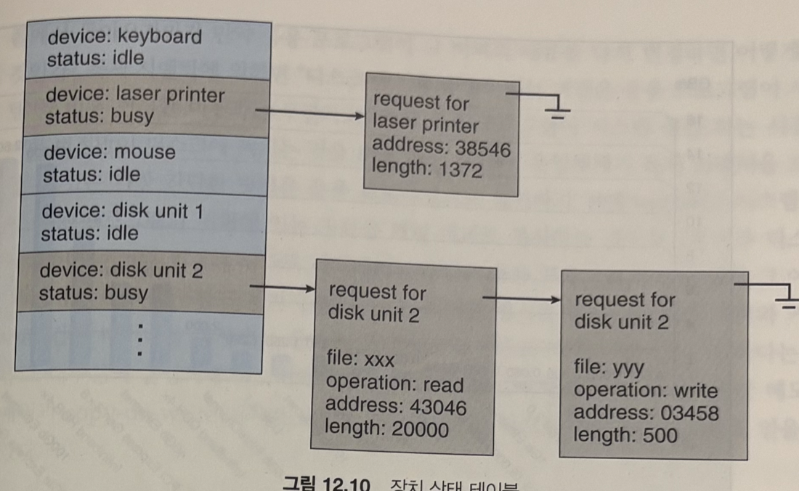
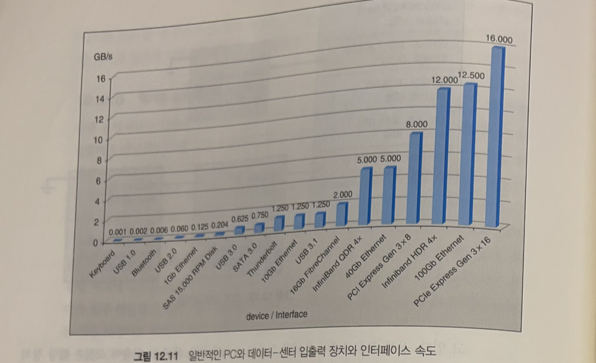
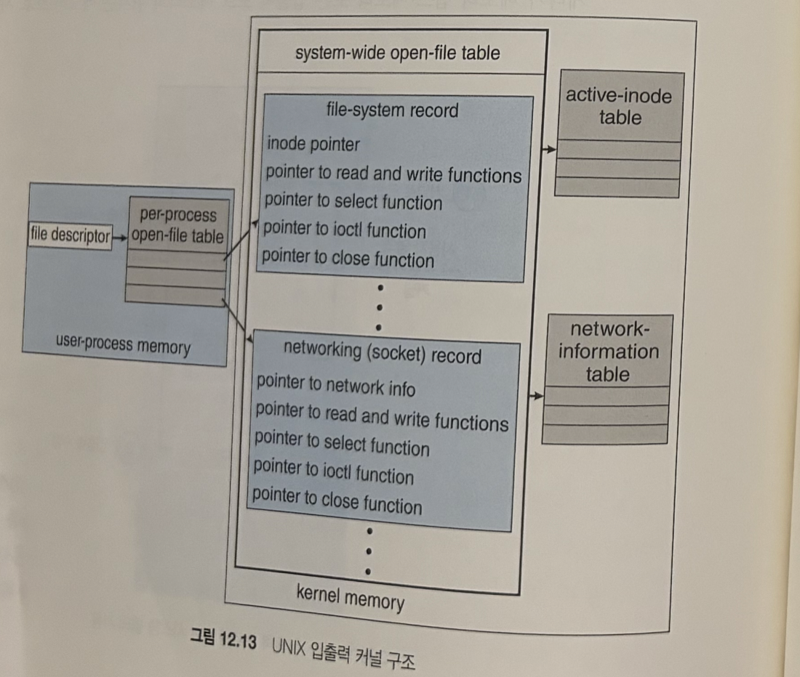
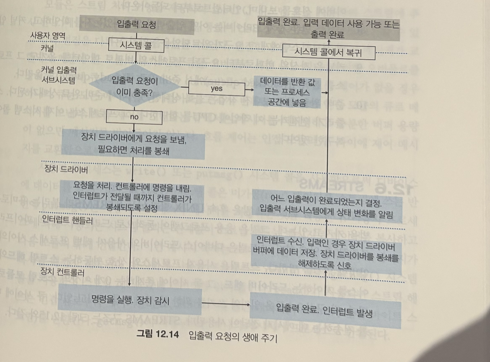
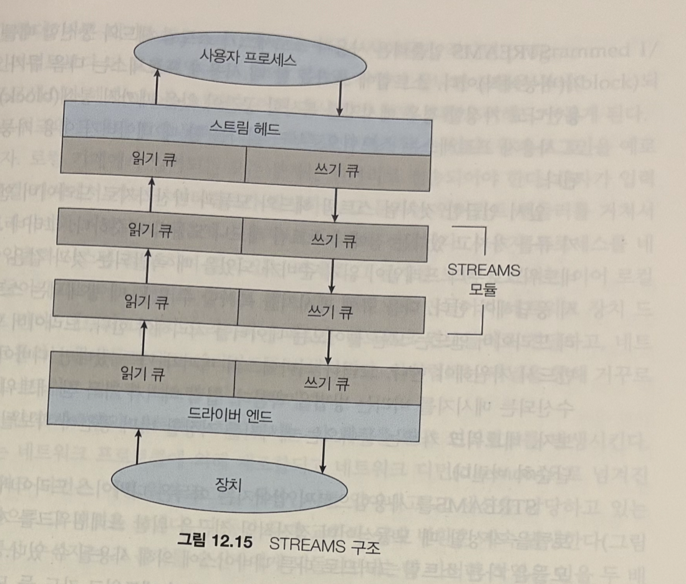
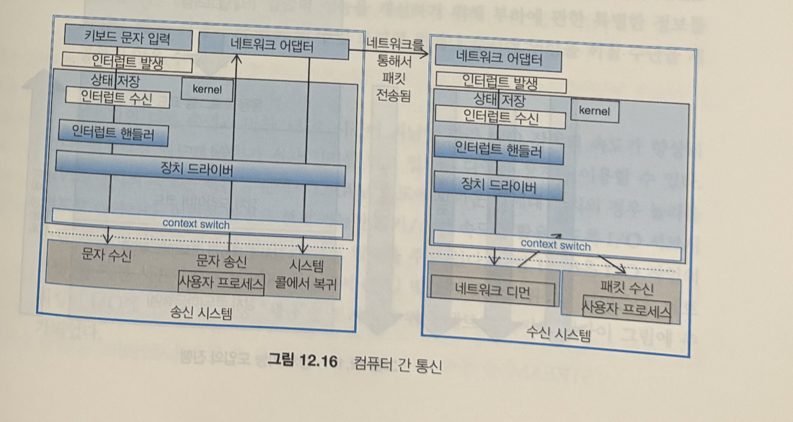
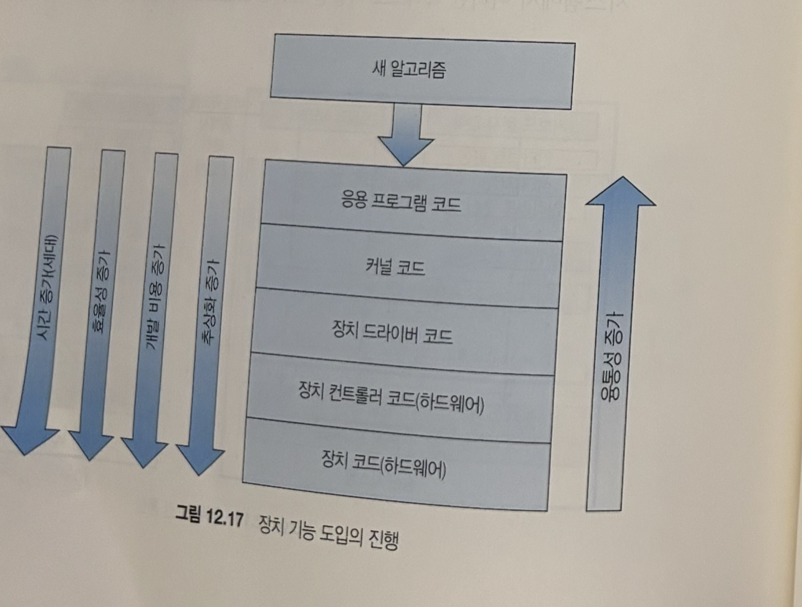

# 입출력 시스템 (12.4 ~ 12.7)

> **이어지는 맥락**
> 지난 범위(12.1~12.3)에서 본 것은 두 개의 "끝"이었다 — 아래쪽 끝인 **하드웨어**(포트·버스·컨트롤러·폴링·인터럽트·DMA, 12.2)와 위쪽 끝인 **응용 인터페이스**(블록/문자 장치·소켓·클록·봉쇄/비봉쇄, 12.3).
> 이번 범위는 그 **두 끝의 사이**를 채운다. ① 커널이 그 사이에서 실제로 제공하는 서비스들(**12.4** — 스케줄링·버퍼링·캐싱·스풀링·보호·전원 관리) → ② `read()` 한 번이 하드웨어 신호까지 내려갔다 오는 **전체 여정**(**12.5**) → ③ 드라이버를 레고처럼 조립하는 **STREAMS**(**12.6**) → ④ 이 모든 계층이 만들어내는 **성능 비용과 그 개선 원칙**(**12.7**).
> 핵심 질문 하나로 꿰면 된다: **"응용이 던진 입출력 요청 하나를, 커널은 그 사이에서 무엇을 해주며, 그 대가는 얼마인가?"**

---

## 12.4 커널 입출력 서브시스템 (Kernel I/O Subsystem)

커널은 입출력과 관련해 **입출력 스케줄링, 버퍼링, 캐싱, 스풀링, 장치 예약, 오류 처리** 등 많은 서비스를 제공한다. 이 서비스들은 앞서 본 하드웨어와 장치 드라이버 구조 위에 세워진다. 그리고 하나 더 — 입출력 서브시스템은 **오류가 있는 프로세스나 악의적인 사용자로부터 자기 자신을 보호할 책임**도 진다(12.4.6에서).

### 12.4.1 입출력 스케줄링 (I/O Scheduling)

**스케줄링 = 밀려든 입출력 요구들의 "실행 순서"를 정하는 것.**

**왜 순서를 바꾸나?** 응용 프로그램이 요청한 순서 그대로(도착순) 처리하면 최상의 성능이 안 나오기 때문이다. 책의 예 —

> 디스크 암(disk arm)이 지금 디스크의 **시작 부분**에 있다. 이때 세 응용이 요청을 보냈다: ① 응용 1은 **끝부분** 블록, ② 응용 2는 **시작 부분** 블록, ③ 응용 3은 **중간** 블록.
> 도착순(1→2→3)으로 처리하면 암이 "끝까지 갔다가 → 처음으로 되돌아왔다가 → 다시 중간으로" 왕복한다. **2 → 3 → 1** 순으로 재배치하면 암이 시작→중간→끝으로 **한 방향으로 쓸고 지나가면** 된다. 이 재배치가 바로 입출력 스케줄링의 임무다.

스케줄링으로 얻는 것 세 가지 — **① 전반적인 시스템 성능 향상, ② 프로세스들 사이의 공평한 장치 접근, ③ 입출력 완료까지의 평균 대기 시간 감소.**

**어떻게 구현하나** — 운영체제는 **장치마다 대기 큐(wait queue)** 를 하나씩 유지한다. 응용이 봉쇄형 입출력 시스템 콜을 하면 그 요청은 해당 장치의 큐에 들어가고, 입출력 스케줄러가 **큐 안의 순서를 재배치**한다. 기본적으로는 공평하게 처리하지만, **급한 요청은 새치기**시켜 주기도 한다 — 예컨대 **가상 메모리의 페이징 요청**은 응용 프로그램의 입출력 요청보다 높은 우선순위로 처리된다. (페이지가 안 올라오면 프로세스 전체가 못 움직이니 당연한 특혜다. 디스크 자체의 스케줄링 알고리즘은 11.2절 참고.)

**비동기 입출력을 지원한다면 — 장치 상태 테이블.** 커널이 비동기 입출력을 제공하면 동시에 **수많은 입출력 요청을 추적**해야 한다. 이를 위해 운영체제는 **장치 상태 테이블(device-status table)** 을 두고 각 장치 항목에 대기 큐를 연동한다.

- 테이블의 각 항목 = 장치 하나. **종류, 주소, 상태**(기능하지 않음 not functioning / 유휴 idle / 동작 중 busy)를 담는다.
- 그림에서 — 키보드·마우스·disk 1은 idle, 레이저 프린터는 busy(요청 1개 매달림), **disk 2는 busy에 요청이 줄줄이** 매달려 있다. 장치가 '동작 중'이면 **같은 장치로 온 새 요청은 그 항목의 큐에 이어 붙는** 것.

> 정리: 입출력 스케줄링은 컴퓨터 효율을 높이는 방법 중 **하나**일 뿐이다. 다른 방법이 바로 이어지는 **버퍼링·캐싱·스풀링** — 메인 메모리나 저장장치의 공간을 "중간 저장소"로 활용하는 기법들이다.

### 12.4.2 버퍼링 (Buffering)

**버퍼 = 두 장치 사이, 또는 장치와 응용 사이에 데이터가 전송되는 동안 그것을 임시로 저장하는 메모리 영역.**

버퍼링이 필요한 이유는 **딱 세 가지**다. 각각 "무엇과 무엇의 **불일치**를 흡수하는가"로 읽으면 된다.

#### 이유 ① — 생산자와 소비자의 "속도" 불일치

파일이 인터넷으로 수신되어 SSD에 저장돼야 한다고 하자. **네트워크는 드라이브보다 천 배쯤 느리다.** 그래서 네트워크로 들어오는 바이트를 메모리 버퍼에 모아두었다가, 버퍼가 다 차면 **그때 한꺼번에** 드라이브에 기록한다.

그런데 드라이브 쓰기가 즉각 끝나는 게 아니고, 그 쓰는 동안에도 네트워크에선 데이터가 계속 들어온다. 그래서 **버퍼를 두 개** 쓴다 — 이게 **이중 버퍼링(double buffering)**:

1. 네트워크가 **버퍼 1**을 채운다 → 다 차면 버퍼 1의 드라이브 쓰기를 요청
2. 버퍼 1이 디스크에 써지는 **동안**, 네트워크는 **버퍼 2**를 채운다
3. 버퍼 2가 찰 때쯤 버퍼 1 쓰기가 끝나 있으므로 → 역할 교대(버퍼 2는 쓰고, 버퍼 1은 다시 받고)

> 비유: 싱크대 앞의 **양동이 두 개**. 하나가 차서 비우러 간 사이에도 수돗물(네트워크)은 계속 나오니, 그동안 나머지 하나가 받는다. 둘이 번갈아가면 물 한 방울 안 흘리고 수도꼭지를 잠글 필요도 없다.

이중 버퍼링의 효과를 책은 이렇게 표현한다 — **생산자와 소비자 사이의 "밀접성(coupling)을 해제"해서 둘 사이의 타이밍 요구를 완화한다.** 즉 둘이 박자를 정확히 맞출 필요가 없어진다. 아래 그림이 왜 이 완충이 필수인지 보여준다 — 장치·인터페이스 간 속도 차이가 **수만 배**에 이른다(막대가 로그가 아니라 실측이라 키보드는 아예 보이지도 않는 수준).

#### 이유 ② — 장치 간 "전송 크기" 불일치

특히 네트워킹에서 흔하다. 송신 측의 **큰 메시지**는 작은 **네트워크 패킷들**로 쪼개져 전송되고, 수신 측은 그 패킷들을 **버퍼에 모아 재조립**해서 원래 데이터를 복원한다. 쪼개고 합치는 중간 작업대가 버퍼다.

#### 이유 ③ — 응용의 "복제 시맨틱(copy semantics)" 보장

**문제 상황부터.** 응용이 자기 버퍼에 디스크에 쓸 데이터를 담아 두고 `write()` 시스템 콜을 불렀다. 운영체제에게는 그 버퍼의 **주소**와 바이트 수가 넘어간다. 그런데 — **시스템 콜에서 복귀하자마자 응용이 그 버퍼 내용을 바꿔버리면?** 디스크에는 옛 데이터가 써지나, 새 데이터가 써지나?

**복제 시맨틱의 약속:** "디스크에 기록되는 버전은 **시스템 콜을 부른 그 시점의 버퍼 내용**이다. 콜 이후에 응용이 버퍼를 바꿔도 무관하다."

**가장 간단한 보장 방법:** `write()`가 응용으로 복귀하기 **전에**, 응용 버퍼의 데이터를 **커널 버퍼로 복사**해 두는 것. 이후 실제 디스크 쓰기는 커널 버퍼↔디스크 사이에서 이뤄지므로, 응용이 자기 버퍼를 아무리 고쳐도 영향이 없다.

> 복사 한 번이 공짜는 아니지만(응용 버퍼→커널 버퍼), **의미가 단순명료**하다는 이유로 대부분의 운영체제가 이 방식을 쓴다. 같은 효과를 **가상 메모리 매핑 + copy-on-write 페이지 보호**를 교묘히 쓰면 복사 없이 더 효율적으로 얻을 수도 있다(쓰려는 페이지를 잠시 공유로 걸어두고, 응용이 건드리는 순간에만 복사).

📖 책에 없는 내용 — 안드로이드 화면의 이중·삼중 버퍼링 (BufferQueue)

이 절의 이중 버퍼링이 안드로이드에서 매 프레임(16.6ms) 일어나는 일이다.

- **앱 ↔ SurfaceFlinger 사이의 `BufferQueue`** — 앱(생산자)이 GPU로 그린 프레임 버퍼를 큐에 넣으면, 화면 합성자 SurfaceFlinger(소비자)가 꺼내 디스플레이로 보낸다. 책의 "생산자-소비자 속도 불일치를 버퍼로 흡수"가 그래픽 파이프라인 구조 그 자체.
- **더블/트리플 버퍼링** — 화면에 표시 중인 버퍼(front)와 그리는 중인 버퍼(back)를 분리하는 게 더블 버퍼링. GPU가 한 프레임을 제때 못 끝내는 경우를 대비해 안드로이드는 버퍼를 하나 더 두는 **트리플 버퍼링**(Project Butter, Android 4.1)으로 잔렉을 줄였다 — "버퍼 개수를 늘려 타이밍 요구를 완화한다"는 책 논리의 연장.
- **복제 시맨틱의 실전판** — `Canvas`에 그린 뒤 버퍼를 큐에 넘기고 나면(`unlockCanvasAndPost`) 그 버퍼를 더 건드리면 안 되는 규칙, Binder로 큰 데이터를 보낼 때 Parcel에 **복사되는 시점**이 호출 시점인 것 모두 "시스템에 넘긴 순간의 버전이 전달된다"는 복제 시맨틱 이야기다.

### 12.4.3 캐싱 (Caching)

**캐시 = 자주 사용될 자료의 "복사본"을 저장해 두는 빠른 메모리 영역.** 캐시된 복사본을 쓰는 게 원본을 매번 쓰는 것보다 효율적이다. 예 — 지금 실행 중인 프로세스의 명령들은 원본이 디스크에 있지만, 물리 메모리에 캐시되고, 다시 CPU의 2차·1차 캐시로 복사되어 올라온다.

**버퍼 vs 캐시 — 헷갈리기 쉬운 구분:**

| | **버퍼(buffer)** | **캐시(cache)** |
|---|---|---|
| 담고 있는 것 | 그 데이터의 **유일한 사본**일 수 있음 (전송 중인 데이터가 여기밖에 없음) | **다른 곳에 원본이 이미 있는** 데이터의 복사본 |
| 존재 이유 | 전송 중 **임시 보관** (속도·크기 불일치 흡수) | **더 빠른 접근** (빠른 곳에 사본을 둠) |

> 한 줄로: **버퍼는 "거쳐가는 곳", 캐시는 "빨리 쓰려고 복사해 둔 곳".**

**그런데 실제로는 한 메모리 영역이 두 역할을 겸한다 — 버퍼 캐시.** 운영체제는 복제 시맨틱 유지와 효율적 디스크 스케줄링을 위해 메인 메모리 버퍼에 디스크 데이터를 담아 두는데(버퍼 역할), 이 영역이 **캐시로도** 쓰인다:

- 커널이 파일 I/O 요청을 받으면 **우선 버퍼 캐시부터 확인** — 해당 영역이 이미 메모리에 있으면 **실제 디스크 I/O를 피하거나 미룰 수 있다.** (여럿이 공유하는 파일, 쓰고 곧바로 다시 읽는 파일에서 효과가 크다.)
- 디스크 쓰기를 **몇 초 동안 버퍼 캐시에 누적**해 두었다가 **대량으로 한꺼번에** 내보낼 수 있어, 효율적인 쓰기 스케줄링이 가능해진다. (이 "쓰기 지연" 전략은 19.8절 원격 파일 접근에서 다시 나온다.)

📖 책에 없는 내용 — 리눅스 페이지 캐시: "남는 RAM은 전부 캐시"

이 절의 버퍼 캐시가 안드로이드가 얹혀 있는 리눅스에선 **페이지 캐시(page cache)** 다.

- **`free`로 보면 메모리가 늘 꽉 차 있는 이유** — 리눅스는 남는 RAM을 놀리지 않고 전부 파일 캐시로 쓴다. 앱이 메모리를 요구하면 캐시를 즉시 회수하면 되므로 "가용 메모리"는 free가 아니라 **available**로 봐야 한다.
- **더티 페이지 라이트백** — 책의 "몇 초 동안 누적 후 대량 전송"이 리눅스의 dirty page writeback 데몬이 하는 일. 그래서 갑자기 전원이 나가면 마지막 몇 초의 쓰기가 유실될 수 있고, 그걸 못 참는 쪽(DB)이 **`fsync()`** 로 "지금 당장 디스크에 내려!"를 강제한다.
- **SQLite가 느린 이유의 절반은 fsync** — 안드로이드 앱의 SQLite는 트랜잭션 내구성을 위해 fsync를 반복 호출한다. WAL 모드가 빠른 것도 fsync 횟수를 줄이는 구조이기 때문. "캐시에 쓰고 미루기 vs 진짜 디스크에 내리기"의 긴장이 앱 성능으로 직결되는 지점이다.

### 12.4.4 스풀링 및 장치 예약 (Spooling and Device Reservation)

**스풀(spool) = 인터리브(interleave)하게 동작할 수 없는 장치를 위해 출력 데이터를 통째로 보관해 주는 버퍼.**

**문제:** 프린터는 **한 번에 한 작업**을 끝까지 처리해야 한다. 여러 응용의 출력을 한 줄씩 섞어 번갈아 찍을 수는 없다(A 문서 1쪽, B 문서 1쪽, A 문서 2쪽… 이런 출력물은 쓰레기다). 그런데 응용들은 **동시에** 출력을 만들어내고, 각자 자기 출력이 안 섞이길 원한다.

**해결 — 스풀링:**

1. 운영체제가 응용→프린터로 가는 **모든 출력을 가로챈다.**
2. 각 응용의 출력을 **각자의 보조저장장치 파일**에 따로 저장한다(= 스풀).
3. 응용이 출력 생성을 **다 끝내면**, 그 스풀 파일을 프린터 출력 **대기 큐**에 넣는다.
4. 스풀링 시스템이 큐의 파일을 **한 번에 하나씩** 프린터로 내보낸다.

> 비유: 여러 손님이 동시에 불러주는 편지를 **각각 다른 종이에 다 받아 적은 뒤**, 완성된 편지부터 **한 통씩** 우체통에 넣는 것. 손님들이 동시에 말해도 편지끼리 섞이지 않는다.

스풀링은 어떤 OS에서는 시스템 **디먼(daemon) 프로세스**가, 어떤 OS에서는 **커널 스레드**가 관리한다. 어느 쪽이든 OS는 프린터 대기 작업을 **열거·취소·일시 중단**할 수 있는 제어 인터페이스를 제공한다(프린터 대기열 창이 바로 그것).

**장치 예약 — 스풀링 말고 다른 방법.** 테이프나 프린터처럼 여러 응용의 요구를 **멀티플렉스할 수 없는** 장치를 조정하는 또 다른 방법은, 아예 **한 프로그램에게 장치를 독점**시키는 것이다(VMS 방식):

- 프로세스가 쉬고 있는 장치를 **명시적으로 할당**받고, 다 쓰면 **명시적으로 반납(deallocate)** 한다.
- 어떤 OS는 그 장치에 대해 **열 수 있는 파일 핸들을 1개로 제한**하는 식으로 독점을 강제한다.
- Windows는 장치 객체가 사용 가능해질 때까지 **기다리는 시스템 콜**을 제공하고, `open()` 할 때 **다른 스레드에게 어떤 접근을 허용할지 선언**하게도 한다.
- 단, 이렇게 프로세스들이 장치를 서로 잡고 기다리다 보면 **교착 상태(deadlock)** 가 날 수 있는데, 그 해결은 **응용 프로그램들의 책임**이다(OS가 대신 안 풀어줌).

📖 책에 없는 내용 — 폰 안에도 스풀러가 산다: PrintSpooler

"요즘 세상에 스풀링?"싶지만 안드로이드에 **`com.android.printspooler`** 라는 시스템 앱이 그대로 들어 있다. 앱에서 인쇄를 누르면 출력이 곧장 프린터로 가는 게 아니라 PrintSpooler가 가로채 작업 큐로 관리하고, 미리보기·취소 UI를 제공한다 — 책의 스풀링 구조(가로채기→파일로 보관→큐→한 번에 하나씩)가 50년을 건너 폰에서도 똑같이 돈다. "느리고 독점적인 장치 앞에는 결국 큐가 놓인다"는 원리는 장치가 바뀌어도 안 변하기 때문.

### 12.4.5 오류 처리 (Error Handling)

보호 메모리를 쓰는 운영체제는 하드웨어·응용의 많은 오류에 대처할 수 있어, 오류 하나가 **시스템 전체 마비로 번지지 않는다.** 오류를 두 부류로 나눠 보는 게 핵심이다:

| 오류 종류 | 예 | OS가 할 수 있는 것 |
|---|---|---|
| **일시적(transient)** | 네트워크에 요청이 일시 쇄도, 디스크 읽기 한 번 실패 | **재시도(재읽기·재전송)로 극복 가능** |
| **영구적(permanent)** | 디스크 컨트롤러 하드웨어 고장 | 중요한 구성요소라면 **완전한 극복은 어려움** |

**오류를 응용에게 알리는 방법** — 일반적으로 입출력 시스템 콜은 **성공/실패 1비트**를 반환한다. UNIX는 여기에 더해 **`errno`** 변수로 **100가지쯤 되는 오류를 구분**해 준다(인자 오류, 잘못된 포인터, 파일을 열 수 없음 등).

**하드웨어는 사실 훨씬 자세히 안다.** 예컨대 SCSI 장치는 문제가 생기면 3단계로 갈수록 상세한 정보를 보고한다:

1. **sense key** — 문제의 유형 (하드웨어 고장인가, 불법적인 요청인가)
2. **additional sense code** — 더 구체적으로 (명령어 몇 번째 인자의 문제인가, 자가 진단 실패인가)
3. **sense-code qualifier** — 한층 더 (어느 인자가, 하드웨어 어느 부분이)

거기다 SCSI 장치는 요청하면 내줄 수 있는 **오류 로그**까지 내부에 보관한다. 하지만 — **이 상세 정보 대부분은 운영체제 선에서 소화되고 응용까지 전달되지 않는다.** (응용은 그저 `errno`나 받는다. 자세한 건 커널 로그의 몫.)

### 12.4.6 입출력 보호 (I/O Protection)

**문제:** 사용자 프로세스가 고의든 실수든 **불법적인 입출력 명령**을 시도하면 시스템 정상 동작이 무너질 수 있다. (아무 프로세스나 디스크 컨트롤러에 직접 명령을 쏠 수 있다면 남의 파일을 덮어쓰는 것도, 시스템을 크래시 내는 것도 자유다.)

**해결 두 겹:**

1. **모든 입출력 명령 = 특권 명령(privileged instruction)** 으로 정의한다. 사용자 모드에서는 입출력 명령을 직접 실행할 수 없고, 반드시 **시스템 콜**로 운영체제에게 대행을 요청해야 한다. 모니터 모드(커널 모드)의 OS가 **요청이 유효한지 검사한 뒤**, 유효하면 수행하고 사용자에게 복귀한다. — 12.2에서 본 "응용은 장치 컨트롤러를 직접 못 만진다"는 보호 원칙이 이렇게 구현되는 것.
2. **메모리 맵드 입출력 영역·입출력 포트 영역도 메모리 보호 시스템으로 잠근다.** 레지스터가 메모리 주소에 사상되어 있으니(12.2.1), 그 주소에 사용자가 마음대로 쓰지 못하게 막아야 입출력 명령 차단이 완성된다.

**단, 무조건 다 막으면 안 되는 예외가 있다** — 그래픽 게임·비디오 편집기·재생 소프트웨어는 성능을 위해 **메모리 매핑된 그래픽 컨트롤러 메모리를 직접 접근**해야 한다. 이럴 때 커널은 접근을 열어주되, **그래픽 메모리의 한 부분(화면의 윈도 하나에 해당)이 한 번에 한 프로세스에만 할당되도록 잠금 기법(locking mechanism)** 을 제공해서 질서를 유지한다.

> 정리: 원칙은 "직접 접근 금지, 시스템 콜로만" — 그러나 성능이 절실한 곳엔 "**잠금을 건 채로 제한적 직접 접근**"을 허용한다. 보호와 성능의 절충.

### 12.4.7 커널 자료구조 (Kernel Data Structures)

커널은 입출력 구성요소들의 **상태 정보**를 유지해야 한다 — open 파일 테이블(14.1절), 네트워크 연결, 문자 장치 통신 상태 등등.

**UNIX의 재미있는 점 — 전부 "파일"로 보이게 한다.** 사용자 파일, raw 장치, 심지어 **프로세스의 주소 공간**까지 파일 시스템 인터페이스로 접근할 수 있다. 그런데 이들 모두 `read()`를 지원하더라도 **속에서 하는 일은 완전히 다르다**:

| `read()` 대상 | 커널이 실제로 하는 일 |
|---|---|
| 사용자 파일 | 디스크 I/O 전에 **버퍼 캐시부터 조사** (12.4.3) |
| raw 장치 | 요청 크기가 **섹터 크기의 정수배**인지, 섹터 경계에 걸치지 않는지 검사 (12.3.1의 raw I/O) |
| 프로세스 이미지 | 디스크 갈 것도 없이 **그냥 메모리에서 읽어옴** |

**"같은 이름, 다른 구현"을 어떻게 한 구조로 묶나 → 디스패치 테이블.** UNIX는 객체지향 기법을 쓴다 — open-file record가 **파일 유형에 따라 알맞은 루틴들을 가리키는 포인터 표(dispatch table)** 를 갖는 것. `read()`를 부르면 그 표에서 이 파일 유형의 read 함수 포인터를 따라간다.

그림 12.13 읽는 법 — 프로세스마다 있는 **per-process open-file table**의 파일 디스크립터가 시스템 전역 **system-wide open-file table**의 레코드를 가리킨다. 그 레코드가 **파일 시스템 레코드**면 inode 포인터 + read/write/select/ioctl/close **함수 포인터들**을, **네트워킹(소켓) 레코드**면 네트워크 정보 포인터 + 역시 함수 포인터들을 담는다. 같은 `read()` 호출이 레코드 종류에 따라 **다른 함수로 디스패치**되는 구조다. (C로 짠 커널이지만 발상은 완전히 가상 함수 테이블이다.)

**한 단계 더 나간 Windows NT — 메시지 전달 방식.** NT는 입출력 서비스를 커널이 직접 수행하지 않고 **입출력 manager**에게 넘긴다. 입출력 요청이 오면 **메시지**로 바뀌어 커널을 거쳐 manager로, 다시 장치 드라이버로 전달된다(출력이면 메시지에 데이터가 담기고, 입력이면 메시지가 버퍼를 가리킴).

| | **프로시저 호출 방식** (전통 UNIX — 드라이버가 커널 안에 함수로 존재) | **메시지 전달 방식** (NT) |
|---|---|---|
| 오버헤드 | 낮음 (커널과 정보를 직접 공유) | **높음** (메시지 변환·전달 횟수 증가) |
| 구조 | 커널이 크고 복잡해짐 | **입출력 시스템 구조·설계가 단순**, 커널이 작아짐, 융통성 큼 |

### 12.4.8 전원 관리 (Power Management)

**데이터 센터에서 —** 전기 요금과 온실가스 문제로 전력 효율이 중요한 목표가 되었다. 전기를 쓰면 열이 나고, 고온은 부품을 고장 내므로 **냉각**까지 문제의 일부다 — 최신 데이터 센터에서 냉각은 **장비 자체 전력의 2배**를 쓸 수도 있다(호수 물, 태양광, 외기 순환까지 동원하는 이유). 운영체제가 하는 일:

- 클라우드 관리 도구와 함께 — 부하를 분석해서, 한 시스템의 **사용자 프로세스를 전부 다른 곳으로 대피**시키고 그 시스템을 유휴로 만든 뒤 **전원을 꺼버린다.** 부하가 다시 필요해지면 켠다.
- 더 미세하게는 — 부하가 낮으면 **CPU 코어를 일시 중단(suspend)** 하고, 실행 큐가 붐비면 재개(resume)한다. 물론 중단 시 코어 상태를 저장하고 재개 시 복원해야 한다.

**모바일에서 — 전원 관리는 우선순위가 가장 높은 축이다.** 배터리로 도는 주머니 속 기기가 데스크톱급 기능을 내려면, OS가 **처음부터 전원 관리를 핵심 기능으로 설계**되어야 한다. 책은 Android의 세 가지 주요 기능을 소개한다:

#### ① 전원 축소 (power collapse) — "꺼진 것에 가까운 깊은 잠"

장치를 **매우 깊은 슬립 상태**로 만드는 기능. 완전히 끈 것보다 아주 미미하게만 전력을 더 쓰면서도, **버튼 누름 같은 외부 자극에는 여전히 반응**할 수 있고 그때 빠르게 다시 켜진다.

- 방법: 화면·스피커·I/O 서브시스템 같은 **개별 구성요소의 전원을 끄고**, CPU를 **가장 낮은 슬립 상태**로 내린다.
- 규모 감각: 최신 ARM CPU는 일반 부하에서 **코어당 수백 밀리와트**를 쓰지만, 최저 슬립 상태에선 **몇 밀리와트**만 쓴다. 이 상태에서도 **인터럽트는 받을 수 있어서** 깨어나 이전 활동을 즉시 재개한다.
- 그래서 주머니 속 유휴 안드로이드 폰은 전력을 거의 안 쓰다가도, 전화가 오면 순식간에 정상 상태로 돌아온다.

#### ② 구성요소 수준 전원 관리 — "누가 뭘 쓰고 있는지 아는 인프라"

**질문:** 그런데 폰이 "플래시 저장장치를 지금 꺼도 안전하다", "I/O 서브시스템 전체를 꺼도 된다"를 **어떻게 아는가?**

**답:** 구성요소 간의 **관계**와 각 구성요소의 **사용 여부**를 추적하는 인프라를 둔다.

- **관계** — Android는 폰의 물리적 장치 위상(topology)을 나타내는 **기기 트리(device tree)** 를 구축한다. 예: 플래시·USB 저장장치는 I/O 서브시스템의 서브노드 → I/O 서브시스템은 시스템 버스의 서브노드 → 시스템 버스는 CPU에 연결.
- **사용 여부** — 각 구성요소는 장치 드라이버와 연결되고, **드라이버가 사용 중인지를 추적**한다(플래시에 대기 중인 I/O가 있는가, 오디오 서브시스템을 열어둔 앱이 있는가).
- **끄는 규칙은 트리를 따라 상향식으로:** 구성요소가 안 쓰이면 끈다 → 버스의 **모든** 서브 구성요소가 안 쓰이면 버스를 끈다 → **트리 전체**가 안 쓰이면 시스템이 전원 축소 모드로 들어간다.

> 비유: 건물 관리인이 **방 → 층 → 건물** 순서로 불을 끄는 것. 방마다 사람이 있는지(드라이버가 사용 추적), 층 전체가 비었는지(버스), 건물이 다 비었는지(트리 전체)를 확인하고 단계적으로 소등한다.

#### ③ wakelock — "지금은 재우지 마" 브레이크

마지막 퍼즐: 사용자가 **게임 중이거나 동영상을 보거나 웹 페이지를 기다리는 중**이라면, 시스템이 멋대로 전원 축소로 들어가면 안 된다. 응용이 **일시적으로 잠들기를 막을 방법**이 필요하다.

- 응용은 필요할 때 **wakelock을 획득(acquire)** 하고 필요 없어지면 **해제(release)** 한다.
- 응용이 wakelock을 쥐고 있는 동안, **커널은 시스템이 전원 축소로 진입하는 것을 막는다.**
- 예: Android Market(현 Play 스토어)이 앱을 업데이트하는 동안 wakelock을 유지 → 업데이트가 끝나면 해제 → 그제야 시스템이 잠들 수 있다.

**범용 컴퓨터에서는 — ACPI.** 전원 관리는 결국 장치 관리 위에 서 있어서 실제로는 더 복잡하다. 부트 시 펌웨어가 하드웨어를 분석해 RAM에 장치 트리를 만들고, 커널이 그걸 보고 드라이버를 적재한다. 이후에도 장치 추가/제거("hot plug"), 상태 변경, 전원 관리가 **실행 중에** 계속 일어나야 하는데, 최신 범용 컴퓨터는 이를 **ACPI(advanced configuration and power interface)** 라는 산업 표준 펌웨어 코드로 관리한다. ACPI는 장치 상태 검색·관리, 오류 관리, 전원 관리를 위해 **커널이 호출할 수 있는 루틴** 형태로 제공된다 — 커널이 장치를 정지시킬 때: 커널 → 장치 드라이버 → ACPI 루틴 → 장치에 지시.

📖 책에 없는 내용 — wakelock 남용과의 전쟁: Doze, JobScheduler, WorkManager

책의 wakelock에는 뒷이야기가 있다 — **앱들이 이 브레이크를 남용해서 배터리 도둑이 됐다.**

- **wakelock 남용 문제** — 백그라운드 앱들이 wakelock을 쥐고 안 놓으면 폰이 영영 전원 축소에 못 들어간다. 한때 "배터리 광탈" 원인 1순위가 wakelock 잡고 폴링하는 앱들이었다.
- **Doze 모드(Android 6.0)** — 그래서 구글은 화면 꺼짐+미사용이 지속되면 **앱들의 wakelock·네트워크·알람을 OS가 강제로 무시하는** Doze를 도입했다. 앱의 "재우지 마"보다 시스템의 "잔다"가 우선하게 뒤집은 것.
- **JobScheduler / WorkManager** — "wakelock 잡고 네가 알아서 깨어 있어" 대신 "**할 일을 OS에 등록하면, OS가 여러 앱의 작업을 묶어서(batching) 한 번 깨어날 때 몰아 실행**"하는 모델로 이동했다. 12.3.3에서 본 AlarmManager 배칭과 같은 철학 — 깨어나는 횟수 자체를 시스템이 통제한다.
- **ARM에는 ACPI 대신 Device Tree(DTB)** — 책 말미의 ACPI는 x86 세계 표준이고, 안드로이드 폰(ARM)은 부트로더가 커널에 **Device Tree Blob**을 넘겨 하드웨어 구성을 알린다. "펌웨어가 하드웨어 목록을 커널에 알려준다"는 역할은 같고 표준만 다르다.

### 12.4.9 커널 입출력 서브시스템 요약

입출력 서브시스템이 관리하는 것들 — 지금까지 본 절들이 이 목록의 어디에 해당하는지 짚으며 읽으면 복습이 된다:

- 파일 및 장치의 **이름 관리** (12.5에서 상세히)
- 파일 및 장치에 대한 **접근 제어**, **작업 제어** (예: 모뎀은 `seek()` 불가 — 12.3의 장치 분류)
- 파일 시스템 **공간 할당**, **장치 할당** (12.4.4 예약)
- **버퍼링·캐싱·스풀링** (12.4.2~4)
- **입출력 스케줄링** (12.4.1)
- 장치 **상태 모니터링, 오류 처리, 고장 복구** (12.4.5)
- 장치 드라이버 **구성 및 초기화**, 입출력 장치의 **전원 관리** (12.4.8)

그리고 상위 계층은 이 모든 것을 **장치 드라이버가 제공하는 공통 인터페이스**를 통해서만 접근한다 — 12.3의 계층화 원칙이 커널 내부에서도 유지되는 것.

---

## 12.5 입출력 요구를 하드웨어 연산으로 변환 (Transforming I/O Requests to Hardware Operations)

**남은 마지막 연결 고리.** 하드웨어 핸드셰이킹(12.2)도 봤고 응용 인터페이스(12.3)도 봤지만, 정작 **"응용이 부른 `read(파일)`가 어떻게 특정 디스크 섹터·특정 컨트롤러 레지스터까지 연결되는가"** 는 아직 안 봤다. 파일을 디스크에서 읽는 경우로 따라가 보자.

**1단계 — 파일 이름 → 디스크 위치.** 응용이 파일명으로 데이터를 참조하면, OS는 파일 시스템 디렉터리를 통해 파일 위치를 알아낸다.

- **MS-DOS(FAT):** 파일명 → 파일 액세스 테이블(FAT)의 항목 번호로 변환 → 그 항목이 **디스크 블록들**을 가리킴.
- **UNIX:** 파일명 → **inode 번호**로 매핑 → 해당 inode가 공간 할당 정보를 담고 있음.

**2단계 — 그런데 "어느 장치인지"는 어떻게 아나?** 두 진영의 답이 갈린다.

| | **MS-DOS 방식** | **UNIX 방식** |
|---|---|---|
| 장치 표현 | 파일명 앞의 **`C:`** 같은 접두어가 장치를 직접 지칭 (콜론으로 파일명과 구분) | 장치 이름공간이 **정규 파일 시스템 이름공간에 통합** — 경로만 봐서는 장치 경계가 안 보임 |
| 장점 | 장치별로 **추가 기능을 붙이기 쉬움** (예: 프린터로 가는 파일엔 스풀링 자동 적용) | 파일 시스템의 **이름 서비스·소유권·접근 제어를 장치가 공짜로 물려받음** |
| 장치 찾기 | `C:` = 주 하드디스크 (OS에 박혀 있는 약속) | **마운트 테이블**에서 경로명과 일치하는 **가장 긴 접두어**를 찾음 → 그 항목이 장치를 알려줌 |

UNIX 쪽을 조금 더 풀면 — 경로명을 해석할 때 마운트 테이블에서 가장 긴 접두어가 일치하는 항목을 찾고, 그 장치 이름을 다시 파일 시스템 디렉터리에서 찾으면 inode 번호 대신 **⟨major, minor⟩ 장치 번호**가 나온다. **주(major) 번호 = 어느 장치 드라이버를 호출할지**, **부(minor) 번호 = 드라이버가 관리하는 장치 테이블의 인덱스** → 그 테이블 항목이 마침내 **장치 컨트롤러의 포트 주소 또는 메모리 맵드 주소**를 내준다. (12.3에서 본 `/dev/sda`의 `8, 0`이 정확히 이 경로로 쓰인다. 파일이 장치 "위에" 저장되므로 이름 하나로 **장치 자체**에도, **그 위의 파일**에도 접근하는 2단 접근이 가능해진다.)

**이 다단계 조회(lookup)가 주는 것 — 유연성.** 최신 OS는 요청과 컨트롤러 사이에 **여러 단계의 lookup table**을 둬서:

- 커널을 **다시 컴파일하지 않고** 새 장치·드라이버를 추가할 수 있다.
- 아예 **요구가 있을 때 드라이버를 그때그때 적재**하는 OS도 있다 — 부트 시 버스를 훑어 하드웨어를 조사하고 드라이버를 적재하되, 그 시점은 부트 때여도 되고 실제 필요해질 때여도 된다.
- 부팅 **후에** 꽂힌 장치는 오류로 감지될 수도 있다 — **핸들러 없는 인터럽트**가 발생하면 커널이 장치를 검사해 적절한 드라이버를 동적 적재한다. (물론 동적 적재/제거는 정적보다 복잡해서 잠금·오류 처리 등 커널 알고리즘이 더 어려워진다.)

### 봉쇄형 읽기 한 번의 생애 주기 (그림 12.14)

이제 전부 조립하자. 프로세스가 봉쇄형 `read()`를 부르면 무슨 일이 일어나는가 — **10단계**다.

1. 프로세스가 이미 열어 둔 파일의 파일 디스크립터에 **봉쇄형 `read()`** 를 부른다.
2. 커널의 시스템 콜 코드가 **인자를 검사**한다. 데이터가 이미 **버퍼 캐시**에 있으면(12.4.3) → 데이터를 바로 반환하고 **여기서 끝**. (그림의 "입출력 요청이 이미 충족? → yes" 지름길)
3. 없으면 물리적 I/O가 필요하다. 프로세스는 **실행 큐에서 대기 큐로** 옮겨지고 I/O가 스케줄된다. 요청은 (서브루틴 호출 또는 커널 내부 메시지로) **장치 드라이버에게** 전달된다.
4. 드라이버는 입력 데이터를 받을 **커널 버퍼를 확보**하고 입출력을 스케줄한다. 그리고 **컨트롤러의 제어 레지스터에 명령을 써 보낸다** (12.2.1의 그 레지스터 쓰기).
5. **장치 컨트롤러가 장치를 작동**시킨다. 데이터가 전송되기 시작한다.
6. 전송 관리는 폴링일 수도, DMA일 수도 있다(12.2.4). DMA라고 하면 — DMA 컨트롤러가 데이터 이동을 전담하고, **전송 완료 시 인터럽트**를 건다.
7. **인터럽트 벡터 테이블**(12.2.3)을 통해 해당 인터럽트 핸들러가 인터럽트를 받고, 장치 드라이버에 신호를 보낸 뒤 복귀한다.
8. 신호를 받은 드라이버는 **어느 입출력이 완료됐는지 확인**하고, 커널 입출력 서브시스템에 완료를 알린다.
9. 커널이 **자기 버퍼의 데이터를 요청 프로세스의 버퍼로 복사**하고(12.4.2의 복제 방향의 역), 프로세스를 **블록 큐 → 준비 완료(ready) 큐**로 옮긴다.
10. 준비 상태가 된 프로세스에 스케줄러가 언젠가 CPU를 할당하면, 프로세스는 **시스템 콜에서 복귀**해 하던 일을 계속한다.

> 이 그림의 교훈: `read()` 한 줄이 **엄청나게 많은 CPU 사이클과 단계**를 소모한다는 것. 12.2의 하드웨어(레지스터·인터럽트·DMA), 12.4의 커널 서비스(버퍼 캐시·스케줄링·큐 이동)가 전부 한 호출 안에서 동원된다. 이 비용 문제의식이 그대로 12.7 성능 절로 이어진다.

📖 책에 없는 내용 — 안드로이드 부팅과 ueventd: "핸들러 없는 장치"를 만나면

이 절의 "부트 시 버스를 조사해 드라이버 적재 + 실행 중 동적 적재"가 리눅스/안드로이드에선 이렇게 돈다.

- **`/dev` 노드는 부팅 때 만들어진다** — 커널이 장치를 발견하면 **uevent**를 쏘고, 안드로이드의 **`ueventd`** 데몬이 그걸 받아 `/dev/…` 장치 노드를 (major, minor 번호로) 생성하고 권한을 설정한다. 책의 "이름 → ⟨major, minor⟩ → 드라이버" 연결의 첫 고리를 부팅 시 자동으로 깔아 두는 셈.
- **`insmod`/`modprobe` = 동적 드라이버 적재** — 책의 "요구에 따라 새 드라이버 적재"가 리눅스 커널 모듈(.ko)이다. 최신 안드로이드는 GKI(Generic Kernel Image) 체제라 제조사 드라이버가 전부 **vendor 모듈로 분리되어 부팅 시 동적 적재**된다 — 커널 재컴파일 없이 장치를 붙인다는 책의 유연성 논리가 안드로이드 생태계 파편화 해결책(Treble/GKI)의 핵심이 됐다.
- **USB를 꽂을 때마다** — OTG로 마우스를 꽂으면 인터럽트 → uevent → 드라이버 바인딩 → `/dev/input/eventN` 생성 → InputReader가 감지. 책의 "부팅 후 추가된 장치 감지" 시나리오가 매일 일어나는 일이다.

---

## 12.6 STREAMS

**STREAMS = 응용 프로그램이 드라이버 코드의 파이프라인을 동적으로 조립할 수 있게 하는 기법** (UNIX System V와 많은 후속 릴리스).

**스트림(stream)이란** — 장치 드라이버와 사용자 프로세스 사이의 **완전 양방향(full-duplex) 연결**이다. 구성은 셋:

- **스트림 헤드(stream head)** — 사용자 프로세스와 맞닿는 쪽
- **드라이버 엔드(driver end)** — 장치를 제어하는 쪽
- 그 사이의 **0개 이상의 스트림 모듈(module)** — 중간 처리 단계들

각 구성요소는 **읽기 큐 + 쓰기 큐 한 쌍**을 가지며, 큐 사이의 데이터 전달은 **메시지 전달(message passing)** 로 이뤄진다.

> 비유: 사용자 프로세스와 장치 사이에 놓인 **조립식 컨베이어 벨트**. 벨트 구간(모듈)을 원하는 만큼 끼워 넣을 수 있고, 각 구간은 위행/하행(읽기/쓰기) 두 레일을 갖는다. 물건(메시지)은 구간에서 구간으로 릴레이된다.

**모듈을 어떻게 끼우나** — 모듈은 스트림 처리 기능(예: 입력 편집)을 제공하며, **`ioctl()` 시스템 콜로 스트림에 푸시(push)** 된다. 예: USB 키보드를 스트림으로 열고, 입력 편집을 담당하는 모듈을 끼워 넣을 수 있다. (12.3에서 본 "만능 뒷문" `ioctl()`의 또 하나의 실전 용도.)

**흐름 제어(flow control) — 큐가 넘치지 않게.** 인접한 모듈의 큐끼리 메시지를 주고받다 보면 한 모듈이 이웃 큐를 **오버플로** 시킬 수 있다. 그래서 큐는 흐름 제어를 지원할 수 있다:

| | 동작 |
|---|---|
| **흐름 제어 없는 큐** | 모든 메시지를 받는 즉시 버퍼링 없이 이웃 큐로 넘김 |
| **흐름 제어 있는 큐** | 메시지를 **버퍼링**하고, **버퍼 용량이 부족하면 받아들이지 않음** — 인접 큐끼리 제어 메시지를 교환하며 "지금 보내도 돼?"를 조율 |

(12.2.2 폴링의 핸드셰이킹이 하드웨어의 박자 맞추기였다면, 이건 소프트웨어 파이프라인 안의 박자 맞추기다.)

**쓰기와 읽기 — raw 바이트로도, 메시지 단위로도:**

| 방향 | 시스템 콜 | 차이 |
|---|---|---|
| 쓰기 | `write()` | **미가공(raw) 데이터**를 스트림에 씀 |
| 쓰기 | `putmsg()` | 사용자가 **메시지를 직접 지정**해서 씀 |
| 읽기 | `read()` | 일반 데이터(**구조화되지 않은 바이트 스트림**)로 받음 |
| 읽기 | `getmsg()` | **메시지 하나** 단위로 받음 |

어느 콜을 쓰든 스트림 헤드가 데이터를 **메시지로 복사**해 다음 모듈의 큐로 전달하고, 이 릴레이가 드라이버 엔드(장치)까지 이어진다.

**어디가 봉쇄되고 어디가 안 되나** — STREAMS 입출력은 **사용자 프로세스가 스트림 헤드와 통신할 때만 봉쇄될 수 있고, 그 외 구간은 비동기**다:

- 쓰기: 다음 큐가 흐름 제어 중이라 **메시지를 복사할 공간이 생길 때까지** 사용자 프로세스가 봉쇄됨
- 읽기: **데이터가 이용 가능해질 때까지** 봉쇄됨

**드라이버 엔드만의 특수 사정** — 드라이버 엔드도 읽기/쓰기 큐를 가진 건 스트림 헤드·모듈과 같다. 하지만:

- 드라이버 엔드는 **인터럽트에 반드시 응답**해야 한다(예: 네트워크에서 프레임 도착). 스트림 헤드는 다음 큐가 꽉 차면 느긋하게 봉쇄되면 그만이지만, 드라이버 엔드는 **들어오는 모든 데이터를 일단 처리해야** 한다 — 하드웨어는 기다려주지 않으니까.
- 그래서 장치 버퍼가 가득 차면 드라이버 엔드는 보통 **수신 메시지를 그냥 버린다(drop)**. 입력 버퍼가 꽉 찬 네트워크 카드가 버퍼 공간이 날 때까지 들어오는 패킷을 단순 폐기하는 것이 전형적인 예다.

**STREAMS의 이득:**

- 디바이스 드라이버·네트워크 프로토콜을 **모듈식·점진적으로** 작성하는 프레임워크 — 모듈은 **다른 스트림, 다른 장치에서 재사용**된다 (같은 네트워킹 모듈을 이더넷 카드와 802.11 무선 카드가 함께 사용).
- 문자 장치 입출력을 밋밋한 바이트 스트림으로만 다루는 대신, **메시지 경계**와 모듈 간 **제어 정보**를 지원한다.
- 대부분의 UNIX 변종이 STREAMS를 지원하며, 프로토콜·드라이버 작성의 선호 방식이었다 — System V UNIX와 Solaris는 **소켓조차 STREAMS로 구현**했다.

📖 책에 없는 내용 — 리눅스는 STREAMS를 거부했다, 그러나 아이디어는 살아 있다

- **리눅스에 STREAMS는 없다** — 성능 오버헤드(모듈마다 메시지 복사·큐잉)를 이유로 리눅스 커뮤니티(와 Linus)가 도입을 거부한 걸로 유명하다. 그래서 안드로이드에도 없다. "유연성(모듈 조립) vs 성능(복사 비용)"의 트레이드오프에서 리눅스는 성능을 택한 것 — 12.4.7의 프로시저 호출 vs 메시지 전달 표와 같은 구도다.
- **하지만 "조립식 파이프라인" 발상은 도처에 산다:**
  - **TTY 라인 디시플린** — 터미널 드라이버와 사용자 사이에 입력 편집 계층을 끼우는 구조. 책이 든 "키보드 스트림에 입력 편집 모듈 푸시" 예제와 정확히 같은 역할을 리눅스에선 이렇게 한다.
  - **netfilter/iptables** — 네트워크 패킷 경로 중간에 처리 훅(hook)을 체인으로 끼워 넣는 구조.
  - **미디어 파이프라인** — 안드로이드의 `MediaCodec` 체인이나 GStreamer/ExoPlayer의 파이프라인(디먹서→디코더→렌더러를 조립)은 STREAMS의 "모듈을 이어 붙여 데이터가 큐로 흐르게 한다"는 설계 그 자체를 사용자 공간에서 재현한 것.
- 요컨대 STREAMS는 커널 기능으로는 졌지만, **설계 패턴으로는 이겼다.**

---

## 12.7 성능 (Performance)

**입출력은 시스템 성능의 주요 인자다.** 어디에 부담을 주는지부터 목록화하면:

- **CPU에** — 장치 드라이버 코드 실행, 프로세스가 봉쇄/해제될 때마다의 스케줄링
- **CPU와 하드웨어 캐시에** — 그로 인한 잦은 **문맥 교환**
- **커널에** — **인터럽트 처리** 부담: 인터럽트마다 상태 저장 → 핸들러 실행 → 상태 복원. 현대 컴퓨터가 초당 수천 개를 처리하지만 결코 싼 작업이 아니다
- **메모리 버스에** — 컨트롤러↔메모리, 커널 버퍼↔응용 공간 사이의 **데이터 복사**

> 폴링이 이길 때도 있다 — 바쁜 대기에서 낭비되는 사이클만 적다면 **programmed I/O가 인터럽트보다 효율적**일 수 있다(12.2.3 말미의 "발생률 높으면 폴링 전환" 이야기와 같은 맥락). 입출력 완료로 봉쇄됐던 프로세스가 풀릴 때도 또 한 번 문맥 교환 비용이 든다.

### 비용 실감 예제 — 원격 로그인의 문자 한 글자 (그림 12.16)

네트워크 트래픽이 문맥 교환을 얼마나 유발하는지 보여주는 책의 예. 원격 로그인 중 **키 하나**를 누르면:

**송신 쪽:** 키 입력 → 키보드 **인터럽트** → 인터럽트 핸들러 → 장치 드라이버 → 커널 → **사용자 프로세스** → 프로세스가 네트워크 I/O **시스템 콜** → 커널 → 네트워크 계층(패킷 구성) → 네트워크 장치 드라이버 → 네트워크 컨트롤러(전송 + **인터럽트**) → 인터럽트가 커널을 거슬러 올라가 시스템 콜 완료.

**수신 쪽:** 네트워크 하드웨어가 패킷 수신 + **인터럽트** → 프로토콜이 문자 재조립 → **네트워크 디먼**에게 전달 → 디먼이 어느 원격 로그인 세션인지 판별 → 그 세션 담당 서브디먼에게 전달. 이 내내 문맥 교환과 상태 전환이 계속된다.

그리고 통상 수신자는 그 문자를 **에코(echo)로 되돌려보낸다** — 위의 전 과정이 **한 번 더**, 일이 두 배가 된다. 글자 하나에 이 소동이다.

**이 부담을 더는 고전적 방법 — 전담 하드웨어에 떠넘기기:**

- **프론트 엔드 처리기(front-end processor)** — 터미널 입출력을 전담해 메인 CPU의 인터럽트 부담을 덜어준다. **터미널 집중기(terminal concentrator)** 는 수백 개 원격 터미널의 트래픽을 하나로 멀티플렉스한다.
- **입출력 채널(I/O channel)** — 메인프레임 등에서 쓰는 **입출력 전용 특수 목적 CPU**. 데이터 흐름을 일정하게 유지하면서 메인 CPU가 그 데이터에 신경 안 쓰게 해준다. 장치 컨트롤러나 DMA보다 **더 일반적이고 복잡한 입출력 프로그램**을 수행할 수 있어 특정 작업에 맞게 조정(tune)될 수 있다.

(발상은 전부 12.2.4 DMA와 같다 — "CPU는 비싸니 입출력 잡일은 전담 하드웨어에게".)

### 입출력 효율을 높이는 6가지 원칙

1. **문맥 교환의 빈도를 줄인다.**
2. 장치↔응용 사이의 **데이터 복사 횟수를 줄인다.**
3. **인터럽트 빈도를 줄인다** — 한 번에 큰 전송을 쓰거나, 지능적인 컨트롤러를 쓰거나, (바쁜 대기를 최소화할 수 있다면) **폴링을 지혜롭게** 쓴다.
4. **DMA·채널로 CPU의 입출력 부담을 덜고**, 입출력과 주 연산이 최대한 **중첩(overlap)** 되게 한다.
5. 원시 처리 연산을 **하드웨어로 구현**해, 장치 컨트롤러 안의 작업이 CPU·버스와 **병렬로** 돌게 한다.
6. **CPU·메모리·버스·입출력의 부하를 균일하게** 한다 — 한 곳의 과부하는 다른 곳들을 놀게 만든다.

> 1~4번이 사실상 이 장 전체의 요약이다: 문맥 교환(12.7), 복사(12.4.2 복제 시맨틱의 비용), 인터럽트 vs 폴링(12.2), DMA(12.2.4).

### 기능을 어디에 구현할 것인가 — 응용 → 커널 → 하드웨어 (그림 12.17)

장치는 복잡도가 천차만별이다 — 마우스는 움직임·클릭을 수치로 바꿔 드라이버에 넘기면 끝이지만, NT의 디스크 드라이버는 개별 디스크에 RAID 배열(11.8절)까지 관리하며 요청 변환·오류 처리·데이터 복구·다단계 성능 최적화를 수행한다. 그렇다면 **새 입출력 기능(알고리즘)은 어디에 구현해야 하나?** 책의 답: **아래 그림을 따라 단계적으로 내려보내라.**

| 단계 | 왜 여기서 시작/이동하나 | 대가 |
|---|---|---|
| **① 응용 프로그램 수준**에서 실험 | **가장 신축적** — 버그가 나도 시스템 전체 크래시로 안 이어짐, 코드 바꿀 때마다 드라이버 재적재·재부팅 불필요 | 문맥 교환 오버헤드 + 커널 내부 기능(효율적 커널 내 메시징·스레딩·락킹)을 못 씀 → **비효율** |
| **② 커널에서 재구현** (①에서 가치가 검증되면) | **성능 크게 향상** | 개발 노력 큼, 커널이 커지고 복잡해짐, 버그가 **시스템 크래시·데이터 파괴**로 이어질 수 있어 신중한 디버깅 필요 |
| **③ 장치/컨트롤러의 하드웨어로** | **최고 성능** | 오류 수정·개선 어려움, 개발 시간 김, **융통성 최소** — 예: 하드웨어 RAID 컨트롤러는 커널이 부하 정보를 알아도 블록 읽기/쓰기의 위치·순서에 개입할 수단을 안 줄 수 있음 |

그림 12.17의 화살표가 그 트레이드오프 자체다 — 아래로 갈수록(하드웨어 쪽) **효율 증가**, 위로 갈수록(응용 쪽) **추상화·융통성 증가, 개발 비용 감소**. 응용 수준 실험의 실례로 **FUSE**가 있다 — 파일 시스템을 **사용자 모드에서** 작성·실행하게 해주는 인터페이스다(느리지만 실험·개발이 안전하고 쉽다).

**마지막 압력 — 장치가 너무 빨라졌다.** NVM 장치의 속도는 빠른 것부터 **DRAM에 근접하는** 차세대까지 다양해졌고, 이 발전은 그 속도를 실제로 활용하라고 **입출력 서브시스템과 OS 알고리즘 전체에 압력**을 주고 있다. (책의 그림 12.18은 CPU·메모리·저장장치·네트워크의 용량-지연시간 지형도를 보여주며, 네트워킹이 I/O에 얹는 성능 "세금"이 얼마나 큰지 드러낸다.)

📖 책에 없는 내용 — 6가지 원칙의 현대 결정판: zero-copy, epoll, io_uring

위 효율 원칙들이 리눅스/안드로이드에서 어떤 발명으로 실현됐는지 짝지어 보면:

- **복사 줄이기 → `sendfile()`/`splice()`, Binder의 단일 복사** — 파일을 소켓으로 보낼 때 커널 버퍼→응용 버퍼→커널 버퍼로 두 번 복사하는 대신, `sendfile()`은 **커널 안에서 바로** 파일→소켓으로 흘린다(zero-copy). 안드로이드 Binder도 송신자→수신자 메모리로 **한 번만** 복사하도록 설계된 IPC다. 12.2.4 박스의 dma-buf(복사 0회)와 같은 계보.
- **문맥 교환/시스템 콜 줄이기 → `epoll`, 그리고 `io_uring`** — 수천 소켓을 감시할 때 `select()`처럼 매번 전체 목록을 넘기지 않고 준비된 것만 통지받는 게 `epoll`(12.3.4 박스). 한발 더 나간 **`io_uring`** 은 응용과 커널이 **공유 메모리에 요청 링(ring)·완료 링을 두고**, 시스템 콜 없이 큐에 넣고 결과를 걷어가게 한다 — "모드 전환 비용 자체를 0에 수렴"시키려는 시도로, 책 12.3.5 벡터형 I/O(콜 횟수 줄이기)의 논리적 종착점이다.
- **인터럽트 줄이기 → NAPI** — 리눅스 네트워크 스택은 패킷이 폭주하면 **인터럽트를 끄고 폴링으로 전환**한다(NAPI). 책 12.2.3 말미의 "발생률 높으면 폴링 전환" 하이브리드가 실제 구현된 것.
- **NVM이 주는 압력의 실물** — 저장장치가 µs급(NVMe)이 되자 "인터럽트 받고 문맥 교환하는 비용 > 장치 대기 시간"인 역전이 일어났고, 이것이 폴링 기반 I/O(io_uring의 폴링 모드, SPDK)가 등장한 직접적 이유다. 그림 12.18이 경고한 바로 그 상황.

---

## (참고) 12.8 요약 — 이 장 전체를 다섯 문장으로

- 입출력의 기본 하드웨어 요소는 **버스, 장치 컨트롤러, 장치** 자신이며, 데이터 이동은 CPU가 직접 하는 **programmed I/O** 또는 **DMA 컨트롤러**가 담당한다.
- 응용을 위한 시스템 콜은 장치들을 **블록/문자 장치, 메모리 맵 파일, 소켓, 타이머** 등의 부류로 묶어 제공하며, 봉쇄형이 기본이지만 **비봉쇄형·비동기** 호출도 제공된다.
- 커널의 입출력 서브시스템은 **스케줄링, 버퍼링, 캐싱, 스풀링, 장치 예약, 오류 처리**, 그리고 파일 이름을 장치 드라이버→장치 주소→물리 주소로 이어주는 **이름 변환**을 제공한다.
- **STREAMS**는 드라이버·프로토콜을 모듈로 쌓아 데이터가 층층이 양방향으로 흐르게 하는 프레임워크다.
- 물리 장치와 응용 사이의 **많은 소프트웨어 계층** 때문에 입출력 시스템 콜은 비싸다 — 보호 경계를 넘는 전환, 인터럽트·시그널 처리, 커널↔응용 버퍼 복사가 주범이다.

> **참고(앞 문서의 정정 재확인):** 책 요약엔 "커널의 보호 경계를 넘을 때의 문맥 교환"이라 쓰여 있지만, 12.3.5에서 정정했듯 시스템 콜 진입 자체는 **모드 전환(mode switch)** 이고, **문맥 교환(context switch)** 은 봉쇄로 인해 다른 프로세스로 갈아탈 때 발생한다. 12.7의 원격 로그인 예처럼 입출력이 진짜 문맥 교환을 대량 유발하는 것은 맞다 — 다만 두 용어는 구분해 두자.

---

> **여기까지가 12장 끝.** 12장은 "장치 ↔ 커널 ↔ 응용"의 수직 연결을 다뤘다. 다음 13~14장(파일 시스템)은 이 위에 올라앉는 가장 중요한 추상화 — **"바이트 덩어리 장치를 어떻게 '파일과 디렉터리'로 보여주는가"** 로 이어진다.
