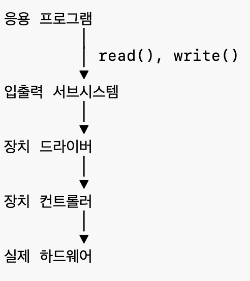

# 12장 입출력 시스템

# 12.1

---



#### 입출력 서브 시스템

- 운영체제가 I/O 장치의 차이를 숨기고 응용프로그램에 일관된 인터페이스 제공
- 적절한 장치 드라이버 호출

#### 장치 드라이버: 장치마다 존재하는 **소프트웨어**

- 운영체제 명령을 장치 명령을 변환하는 역할
- 운영체제 입장에서는 read() 를 호출하면 드라이버를 통해 GPU, SSD, USB 등에 대해 동일하게 읽기 동작이 수행될 수 있음

ex) Printer Driver, GPU Driver, SSD Driver

# 12.2 - I/O HW

---

각 하드웨어는 포트를 통해 접속되고 하나 이상의 장치들이 공통 선을 사용하면 이를 버스라고 함
어떻게 해야 메시지를 주고받을 수 있는지를 정한 프로토콜도 있어야함

### 데이지 체인

여러 장치에서 동시에 인터럽트가 발생했을 때 어떤 장치를 먼저 처리할지 결정하는 하드웨어 방식
CPU에 가까울수록 우선순위가 높음

### **PCI (Peripheral Component Interconnect)**

CPU(또는 메모리)와 주변장치를 연결하는 표준 통신 버스. 모든 장치가 하나의 PCI 버스에 연결됨. 
예전에는 장치마다 연결 방법이 달라 운영체제가 다 따로 처리해야 했는데 지금 모든 장치는 PCI 규칙만 따르면 연결 가능

### **PCI Express(PCIe)**

PCI는 여러 장치가 하나의 버스를 공유하는데 요즘은 각 장치가 CPU와 전용 연결을 가짐. 예전의 개별 포트를 가질 때와 다른 점은, 예전에는 표준 규격이 없이 다 각자의 방식대로 연결했다면, PCIe CPU에 PCIe Lane이 있고 장치마다 1:1의 lane을 선점해서 사용하는 방식임

두 개의 신호쌍(한 쌍은 수신용, 한 쌍은 전송용. 총 4개의 선이 있음)으로 구성된 전이중 바이트 스트림 (8비트를 양방향으로 전송)
즉 CPU가 SSD로 명령을 보내는 동시에 SSD는 CPU로 데이터를 보낼 수 있음 
8개의 레인을 사용하는 PCIe 카드나 커넥터는 x8로 불림

| 장치 | PCIe |
| --- | --- |
| Wi-Fi 카드 | x1 |
| 캡처 카드 | x4 |
| 고성능 SSD | x4 |
| 그래픽카드 | x16 |

### 컨트롤러

포트, 버스, 장치를 작동할 수 있는 작은 컴퓨터
CPU, RAM, 펌웨어 등 구성은 복잡도에 따라 다름)

- CPU 명령을 장치가 이해하는 명령으로 변환
- 장치의 복잡한 동작 처리

→ CPU의 부담 감소

## 12.2.1 - 메모리 맵드 입출력

CPU는 컨트롤러의 레지스터를 읽고 쓰면서 장치를 제어함
보통 아래 네 가지 레지스터가 있고 보통 1~4바이트 정도다.

| 레지스터 | 역할 | 쓰기 주체 |
| --- | --- | --- |
| 제어 레지스터 | CPU가 장치에게 전달하고자 하는 명령 저장 | CPU |
| 출력 레지스터 | CPU → 장치 데이터 저장 | CPU |
| 입력 레지스터 | 장치 → CPU 데이터 저장 | 장치 컨트롤러 |
| 상태 레지스터 | 현재 장치 상태(Busy, Ready, Error) | 장치 컨트롤러 |

예시1: 키보드 입력

- 키보드에 A를 입력 → [입력 레지스터] A 저장, [상태 레지스터] Ready → 인터럽트 발생 
→ CPU가 상태 레지스터 확인

예시2: CPU가 SSD를 읽으려고 할 때

- [출력 레지스터] block = 100, [제어 레지스터] READ → SSD 컨트롤러가 읽음 → [입력 레지스터] 에 읽은 데이터 저장, [상태 레지스터] Ready

### Memory-Mapped I/O

- 위 레지스터들이 메모리 공간에 배치되기 때문에 CPU 입장에서 그냥 메모리에 접근하는 것처럼 동작함
- 장점: 메모리 접근 명령만 사용하면 되고 별도의 명령 사용이 필요 없음

### Polling

- CPU가 계속해서 컨트롤러의 상태 레지스터의 busy bit를 검사한다 (busy waiting)
- 컨트롤러가 하던 일을 끝내고 busy bit를 0으로 하면 CPU는 쓰기 비트를 설정하고 출력 레지스터에 데이터를 쓴다
- CPU가 명령 준비 완료 비트를 쓰면 컨트롤러가 이를 확인해서 busy bit를 1로 설정한다

⇒ CPU가 계속 기다리게 되니 효율적이지 않다

## 12.2.3 Interrupt

CPU 하드웨어에 ‘**인터럽트 요청 라인**’이라는게 있는데, 다음 명령을 실행하기 전에 이걸 확인한다
컨트롤러는 이 요청 라인에 신호를 보내면 CPU가 레지스터와 상태 정보를 저장하고 메모리상의 인터럽트 핸들러 루틴으로 jump 한다

인터럽트 라인 종류

1. 마스크 불가 인터럽트
    - 회복 불가능한 메모리 오류와 같은 이벤트
2. 마스크 가능 인터럽트
    - 필요하면 CPU가 인터럽트 기능을 중지시킬 수 있음
    - 장치 컨트롤러(키보드, 마우스 같은..)가 서비스를 요청하기 위해 사용함

### 인터럽트 백터

특정 인터럽트 핸들링 루틴을 사용하기 위한 테이블 오프셋
보통 벡터 내 주소보다 장치가 더 많기 때문에 인터럽트 사슬화 기능 사용
*인터럽트 사슬화: 하나의 백터값을 여러 장치가 사용하고 CPU가 검사해서 찾는다
 ⇒ 인터럽트 100번이 발생하면 인터럽트 백터에서 해당 번호의 인터럽트 핸들러를 찾아 처리한다

### 인터럽트 우선순위

인터럽트 처리는 두 단계로 이루어짐

1. FLIH (First-Level Interrupt Handler): 빠르게 끝내야 하는 작업
    - 문맥교환, 상태 저장..
    - 필요한 최소 작업
    - 나머지 작업 예약
2. SLIH (Second-Level Interrupt Handler): 시간이 오래 걸리는 작업
    - 데이터 복사
    - 프로세스 깨우기

시간이 오래걸리는 작업은 나중으로 미뤄서 처리함

## 12.2.4 DMA (Direct Memory Access)

> CPU 대신 장치와 메모리 사이의 데이터 복사를 해주는 HW
> 

보통 SSD가 메모리에 접근하려면 (SSD → CPU → 메모리)순으로 거져야 하지만(PIO)
DMA는 CPU를 거치지 않고 메모리에 직접 접근

메모리에 전송할 데이터의 위치, 전송할 장소, 전송될 바이트 수를 DMA 명령 블록을 쓰고 분산-수집 방식을 써서 한번의 DMA명령을 통해 여러 개의 전송을 실행할 수 있도록 한다
(* 분산-수집 방식: 전송할 데이터의 위치 여러 개를 한번에 주면 모든 위치에 접근해서 한번에 수행함)

목표 주소가 커널 주소 공간에 있으면 전송 중에 수정될 여지가 적어서 
예전에는 커널 버퍼에 저장하고 이걸 사용자 버퍼에 다시 한번 복사하는 이중 버퍼링을 사용했음.

→ 요즘은 바로 사용자 버퍼에 복사되게 하고 전송하는 동안 그 메모리에 접근하지 못하게 OS가 보호함

#### DMA 컨트롤러-장치 컨트롤러간 핸드쉐이킹

DMA-request, DMA-acknowledge라는 선 이용

1. 장치 컨트롤러가 전송할 데이터가 생기면 DMA-request 선에 신호를 보냄
2. 신호를 받은 DMA 컨트롤러가 메모리 버스를 얻어 거기에 원하는 주소를 올려두고 DMA-acknowledge 선에 신호를 보냄
3. 장치 컨트롤러가 데이터를 전송하고 DMA-request 를 제거함
4. 전송이 끝나면 DMA에 CPU에 인터럽트를 걸음

#### DVMA (Direct virtual memory access)

직접 가상 주소 접근. CPU나 메모리 개입 없이 가장 주소로 두 개의 메모리장

# 12.3 응용 입출력 인터페이스 (Application I/O Interface)

---

운영체제는 장치마다 다른 동작 방식을 숨기고 **응용프로그램에는 동일한 인터페이스를 제공**한다.

예를 들어

```
read()write()open()close()
```

는 SSD, HDD, USB, 키보드에서 
모두 동일한 방식으로 사용할 수 있다. 실제 장치 제어는 **장치 드라이버**가 담당한다.

### 장치 종류

1. Block Device (블록 장치)

데이터를 **고정된 크기의 블록 단위**로 저장한다.

특징

- 임의 접근(Random Access) 가능
- 버퍼 캐시 사용
- 블록 번호로 접근

예시

- SSD
- HDD
- USB 저장장치

대표 시스템 콜

```
read()write()
```

2. Character Device (문자 장치)

문자(스트림) 단위로 데이터를 전달한다.

특징

- 순차 접근
- 블록 번호 개념 없음
- 버퍼 캐시 거의 사용 안 함

예시

- 키보드
- 마우스
- 직렬 포트

3. Network Device (네트워크 장치)

일반 파일처럼 접근하지 않고 소켓(Socket)을 통해 통신한다.

대표 시스템 콜

```
socket()send()recv()
```

### Blocking I/O

I/O가 끝날 때까지 프로세스가 기다린다.

[read() → 데이터 없음 → 프로세스 block → 데이터 도착 → wake up]

- 장점: 구현 단순
- 단점: CPU를 활용하지 못함

#### Non-Blocking I/O

I/O가 끝나지 않아도 즉시 반환한다.

[read() → 데이터 없음 → 즉시 반환 → 나중에 다시 확인]

- 장점: CPU를 다른 작업에 활용
- 단점: 계속 확인해야 할 수도 있음

### Asynchronous I/O

I/O를 요청한 후 프로세스는 다른 작업을 계속 수행한다. 완료되면 운영체제가 인터럽트나 시그널 등으로 알려준다.

[read() → 다른 작업 수행 → I/O 완료 → 운영체제가 알려줌]

Blocking과의 차이

- Blocking: 기다림
- Async: 기다리지 않음

### Memory-Mapped File

파일을 메모리처럼 사용할 수 있다.

- 기존 방식: Disk → read() → Memory
- Memory Mapping: Disk File → Virtual Memory → 프로그램

장점

- read()/write() 호출 감소
- 큰 파일 처리 효율적

# 12.4 커널 입출력 서브시스템

---

> 운영체제 내부에서 I/O를 효율적으로 처리하기 위한 기능들
> 

#### Scheduling (I/O Scheduling)

여러 I/O 요청의 순서를 조정한다.

목적: 응답시간 감소

#### Buffering

속도가 다른 장치 사이에서 임시 저장 공간을 사용한다.

[Disk → Buffer → Application]

목적: 속도 차이 완화

### Caching

자주 사용하는 데이터를 메모리에 저장한다.

[Disk → Cache → CPU]

장점

- 디스크 접근 감소
- 성능 향상

### Spooling

여러 프로세스가 한 장치를 공유할 수 있도록 대기열을 만든다.

예) 프린터

[프로세스 A → 프로세스 B → 프로세스 C → Print Queue → Printer]

프린터는 한 번에 하나만 출력 가능

### Error Handling

I/O 오류 처리

예)

- 재시도
- 오류 기록(Log)
- 사용자에게 오류 반환

### I/O Protection

사용자 프로그램이 하드웨어를 직접 접근하지 못하도록 보호
커널이 driver와 controller를 통해서만 접근할 수 있도록 보호함

## 12.4.7 커널 자료구조 (Kernel Data Structures)

> 커널은 모든 입출력 장치의 상태를 관리하기 위해 여러 자료구조를 유지한다.
> 

대표적으로

- open file table
- inode table
- socket table
- device table

등을 관리한다.

#### open file table

파일을 열면

```
process

↓

file descriptor (3)

↓

per-process open file table

↓

system-wide open file table

↓

inode
```

순서로 접근한다.

- per-process open file table: 프로세스마다 가지고 있는 같은 파일 디스크립터 테이블.
- system-wide open file table: 실제 열린 파일의 정보.
    - 포함하는 정보
        - 현재 offset
        - read 함수
        - write 함수
        - ioctl 함수
        - close 함수…
    - 여러 프로세스가 같은 파일을 열면 같은 open file record를 공유할 수도 있다.
- dispatch table: 객체 종류마다 read()의 구현이 다르다.
    - 파일 read():  디스크 읽기
    - 소켓 read(): 네트워크 수신
    - 파이프 read(): 파이프 버퍼 읽기
    
    ⇒ read() → 객체 확인 → 맞는 함수 호출
    

## 12.4.8 Power Management

운영체제는 전력 소비를 줄이는 것도 중요한 역할이다.

1. Power Collapse
    
    사용하지 않을 때 CPU와 장치를 깊은 Sleep 상태로 만든다. 필요하면 인터럽트로 즉시 깨어난다.
    
2. Component-level Power Management
    
    전체를 끄는 것이 아니라 필요 없는 구성요소만 끈다.
    
    예)
    
    - USB
    - Flash
    - Audio
    - Wi-Fi
3. Device Tree
    
    Android는 장치들의 연결 관계를 트리 형태로 관리한다.
    
    ```
    CPU
    
    └── Bus
    
          ├── USB
    
          ├── Flash
    
          └── Audio
    ```
    
    사용하지 않는 하위 노드부터 끈다.
    
4. WakeLock
    
    Android의 대표 기능. 원래는 사용 안하면 sleep 하는데 앱이 WakeLock를 획득하면 Sleep으로 들어가지 않는다.
    
    예)
    
    - 음악 재생
    - 다운로드
    - GPS
    
    작업이 끝나면
    
    WakeLock 해제.
    
5. ACPI (Advanced Configuration and Power Interface)
    
    운영체제가 하드웨어의 전원을 제어하기 위한 **표준 인터페이스**
    
    [장치 끄기 → ACPI 호출 → BIOS/펌웨어 → 장치 전원 OFF]
    
    순으로 수행한다.
    

# 12.5 입출력 요청을 하드웨어 연산으로 변환

---

사용자가

```
read("a.txt")
```

를 호출하면 바로 디스크를 읽는 것이 아니다.

1. read() 호출
2. 버퍼 캐시에 있는지 확인
3. 없으면 Driver 호출
4. Driver가 Controller에 명령
5. Controller가 장치 제어
6. DMA 전송
7. 완료 인터럽트
8. Driver가 완료 확인
9. Kernel Buffer → User Buffer 복사
10. 프로세스 Ready 상태

## Mount Table

> 경로와 실제 저장장치를 연결하는 테이블
> 

UNIX에서는

```
/home
/dev
/usr
```

같은 경로가 실제 어느 장치인지 Mount Table이 관리한다.

예)

/home → SSD1 → inode 조회 → 데이터 읽기

## Major Number

어떤 장치 드라이버를 사용할지 나타내는 번호.

예)

```
major = 8

↓

SCSI Disk Driver
```

## Minor Number

같은 드라이버 안에서 실제 어떤 장치를 사용할지 나타낸다.

예)

```
major = SSD Driver

minor = Disk0
minor = Disk1
minor = Partition2
```

# 12.6 STREAMS

---

UNIX의 입출력 프레임워크. 장치와 사용자 사이에 여러 모듈을 자유롭게 끼울 수 있다.

```
Application

↓

Head

↓

Module

↓

Module

↓

Module

↓

Driver End

↓

Device
```

각 모듈은 읽기 큐, 쓰기 큐를 가진다.

장점

- 모듈 재사용
- 네트워크 프로토콜 구현 쉬움
- 필터 삽입 가능

## Stream Head

사용자 프로세스와 STREAMS를 연결하는 시작점.

```
Application

↓

Stream Head

↓

Modules

↓

Driver
```

모든 read(), write()는 먼저 Stream Head를 통과한다.

## Driver End

장치와 직접 연결되는 STREAMS의 끝부분.

실제 장치 드라이버 역할을 한다.

```
Application

↓

Stream Head

↓

Modules

↓

Driver End

↓

Device
```

## Flow Control (흐름 제어)

큐가 가득 찼을 때 무조건 계속 데이터를 보내는 것이 아니라 잠깐 멈추는 기능. 큐가 넘치지 않도록 전송량 조절

예)

```
Network

↓

Queue Full

↓

Stop

↓

Queue Empty

↓

Resume
```

---

입출력 성능을 높이는 원칙

1. 문맥교환 줄이기
2. 인터럽트 줄이기. 작은 데이터마다 인터럽트를 발생시키지 않는다.
3. DMA 적극 사용
4. CPU와 I/O 병렬 수행 (CPU가 계산하는 동안 DMA는 데이터 전송)
5. 부하 균형 (CPU, 메모리, 버스, 장치 모두 적절히 활용)

### 장치 기능은 어디에 구현하는 것이 좋은가?

- 처음에는 응용 프로그램에서 구현한다.
- 좋은 알고리즘이면 커널로 옮긴다.
- 더 자주 쓰이면 장치 드라이버
- 가장 성능이 중요하면 하드웨어

**성능은 올라가지만 유연성은 떨어진다.**

## Front-end Processor

메인 CPU 대신 입출력을 전담하는 작은 프로세서.

예)

메인프레임에서

- 키보드
- 터미널
- 네트워크

입출력을 대신 처리한다.

## Terminal Concentrator

여러 개의 터미널을 하나의 시스템으로 모아주는 장치.

```
Terminal1
Terminal2
Terminal3
↓

Terminal Concentrator
↓

Computer
```

## I/O Channel

DMA보다 더 강력한 전용 I/O 프로세서. DMA는 메모리 복사만 잘하지만,

I/O Channel은

- 여러 I/O 명령 실행
- 프로그램 수행
- 순차 작업

까지 처리한다.

메인프레임에서 많이 사용된다.
